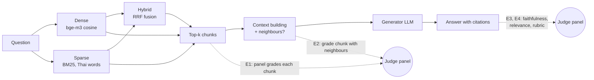
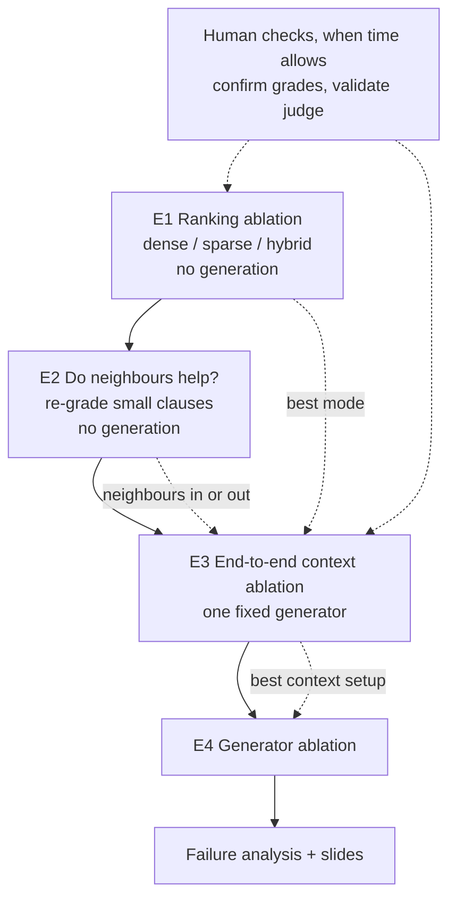

# Ablation plan: retrieval, context and generator (on the frozen chunks)

Status: draft 2026-10-23. Tracks what we run next, and why, now that the corpus and the chunks are frozen. The details behind each earlier decision are in `generation-and-eval.md` (generation, judges, top-50 diagnostic) and `rag-baseline.md` (chunking, retrieval). This file is meant to be read on its own.

## Where we are

| Done | Not done |
|---|---|
| Corpus settled; **2,070 chunks frozen** from 173 documents (a test fails if they change) | Any run on the frozen chunks. Both earlier dev runs, their human labels and the top-50 diagnostic were made on the **old** chunks, so they are background, not results |
| Retrieval: dense (bge-m3), sparse (BM25), hybrid (RRF) | Retrieval metrics beyond E1 (E1 is done, see the Log); E2 onward |
| Generation (`rag/answer.py`) and a demo (`demo.py`) | A generator we can report: the only one so far is a GPT dev stand-in, from the same family as one judge |
| Answer scoring: RAGAS faithfulness, RAGAS answer relevance, rubric judge; a three-judge panel checked against human labels | Ablations, failure analysis, slides, the AI audit in the course template |

**Constraint:** people have little review time right now. Everything on the critical path below runs without a person; human checks are listed separately and make the same results stronger when done.

## The system in one picture

Each experiment changes or measures one part of the pipeline (E1–E4 below).

- **Chunks** are one structural unit when it fits (a FAQ item, a มาตรา, a ข้อ or an `(N)` item of a legal instrument, a guide section), at most 512 tokens. Legal clauses are the smallest: median 148 tokens, 189 under 100. Each chunk's header carries the document title and the parent clause's opening words.
- **Judge panel**: three LLM judges from different families (`gpt-6-sol`, Claude Haiku 5.5, DeepSeek V4.1 Flash), combined by median. On the dev labels it agreed with people about as well as people agree with each other, but it is more lenient than people on hard questions: in the top-50 diagnostic people kept 25 of 132 chunks the panel called "answers it". So panel numbers are reliable for **comparing variants** (the same judges grade every variant) and too generous as **absolute** numbers.

## Plan at a glance

| # | Experiment | Needs generation | Needs a person | Status |
|---|---|---|---|---|
| E1 | Ranking ablation: dense vs sparse vs hybrid | no | no | **done 2026-10-23** (`rag/pooled.py`); result in the Log |
| E2 | Does adding neighbouring clauses make a chunk answer the question? | no | no | to build, after E1 |
| E3 | End-to-end: does better retrieval or context give better answers? | yes, one generator | no | needs the generator chosen |
| E4 | Generator ablation | yes, 3–4 generators | no | needs the generator list |
| H | Confirm the panel's chunk grades; validate the judge on new answers | no | yes | when someone has time |

How this maps to the assignment: **E1 (and E3) is the required ablation** (slides 6–7). **E3 and E4 give the required ≥ 2 metrics** (RAGAS faithfulness, RAGAS answer relevance, LLM-as-judge; slide 8). Failures found along the way feed slide 9.

## Question sets

| Set | What | Used by |
|---|---|---|
| **Content questions** | All normal and multi-turn questions: 338 (the one out-of-scope question and the 30 behavioural ones excluded, because they test how the answer behaves, not which chunks come back) | E1, E2 |
| **Ablation subset** | Drawn once, with a fixed seed, from questions **not** in the dev set: about 6 per content category (16 categories), all 9 non-dev multi-turn questions (with their earlier turns), all 26 non-dev behavioural questions. About 130 | E3, E4 |
| Dev set | The 40 dev questions. We have read them closely and tried things on them, so they are not used to report answer results | smoke tests only |

E1 includes the dev questions because nothing about retrieval was tuned on them; it is reported both with and without them anyway.

---

## E1 Ranking ablation (dense vs sparse vs hybrid)

**Question.** Which retrieval mode puts chunks that answer the question near the top, and why?

**Design.**

1. For each content question, take the top 10 of dense, sparse and hybrid and pool them (the union). The modes overlap a lot: about 21 distinct chunks per question, about 7,000 pairs in all, against 10,000+ if each mode were graded separately.
2. Each judge grades every (question, chunk) pair once on the rubric's scale: **2** answers it (or a necessary part), **1** on topic but does not answer, **0** not relevant. Chunks are shown in shuffled batches of 10, without the mode or rank they came from, and without any answer.
3. The grades are reused for every mode: a mode's score is computed from where it ranked the graded chunks.
4. About 700 calls per judge. Grades are stored per question, chunk id and chunk text hash, so a later variant (a reranker, k = 10) only grades the chunks it adds.

This reuses the grading code of the top-50 diagnostic (`rag/depth.py`).

**Metrics,** per mode, overall and per category:

| Metric | Meaning |
|---|---|
| hit@5 | share of questions with at least one "2" in the top 5 |
| precision@5 | share of the top 5 graded 2 |
| MRR@10 | 1 / rank of the first "2" in the top 10, averaged |
| nDCG@10 | uses the 0/1/2 grades and their ranks; rewards good chunks near the top |
| recall@10 (pool) | share of the pool's "2"s found in the mode's top 10; relative to the pool, not to the whole corpus |

Each is reported twice: a "2" as the panel **median** (lenient) and as **all three judges** say 2 (strict). Differences between modes are tested per question (paired), with a bootstrap interval.

**Assumptions.**

- The panel's grades are good enough to **rank** modes even though they are lenient. Leniency hits every mode alike.
- Chunks none of the three modes found are never graded, so recall is relative to the pool.
- A chunk is graded alone. A clause that answers only with its neighbours counts as a 1 here; E2 is about that.

**Outcomes and what we do.**

| Outcome | Then |
|---|---|
| Hybrid ≥ both single modes, beyond the interval | Hybrid stays the baseline. Explain the mechanism per category: where BM25 wins (exact terms: form names, section numbers, amounts) and where dense wins (paraphrase, colloquial questions; the "ภาษาพูด" category). |
| A single mode beats hybrid | That mode becomes the baseline for E3. Look at why fusion hurts (e.g. one ranking adds noise at ranks 1–5 for some categories) before changing RRF settings. |
| Differences inside the interval | Report "no measurable difference"; keep hybrid for robustness and say so. The ablation is still valid: explaining why they tie is the point. |
| Median and strict disagree on the winner | Report the result as unsure. A person grades a sample of the disputed chunks (H1) before E3 relies on it. |
| Many questions with no "2" anywhere in the pool | Corpus gaps or wording mismatch, not ranking. List them for failure analysis; do not tune on them. |

---

## E2 Do neighbouring clauses help?

**Question.** Legal clauses are small. Is a clause often "on topic but not enough" because the condition, exception or definition it needs sits in the next clause?

This is a **hypothesis**, not a finding. Part of the gap is already covered: a clause's header includes the opening words of its parent มาตรา or ข้อ. What the header does **not** carry is sibling items ("ทั้งนี้ …", exceptions, definitions in another ข้อ).

**Design.**

1. Take clause chunks in any mode's top 5 that the panel graded **1** in E1.
2. Grade each twice more, in the same blind setup as E1:
   - **expanded**: the chunk plus its neighbours (siblings in the same parent unit; capped, e.g. 512 extra tokens);
   - **alone again**: the same chunk as in E1, as a control. A 1 can become a 2 just by asking again, and this measures how often.
3. Also expand a sample of chunks graded **2**, to see whether neighbours dilute them.

A few hundred calls in all.

**Metric.** The share of 1s that become 2 when expanded, minus the share that become 2 when asked again alone (the noise floor).

**Assumptions.**

- "Neighbour" means the same parent unit. The previous and next chunk in the file can belong to another section, so they are only a fallback.
- A judge that can see more text is not simply more generous. The "alone again" control and the dilution check are there to catch that.

**Outcomes and what we do.** The threshold is to be agreed before the run (proposed: 10 points over the noise floor).

| Outcome | Then |
|---|---|
| Expanded clearly above the floor | Neighbours become a variant in E3. |
| About the floor | Neighbours do not help at this level; E3 runs without them. Report it as a tested and rejected idea: a measured negative result is good ablation material. |
| Expansion often turns 2s into 1s | Expansion dilutes; if it is still tried in E3, add only the parent's opening words or a smaller cap. |
| The gains come from a few document types | Expand only those (e.g. legal clauses), not FAQ items, which already contain their own question and answer. |

---

## E3 End-to-end context ablation

**Question.** Do the retrieval and context changes from E1 and E2 give **better answers**? Retrieval metrics alone cannot show this. Neighbours change only what the generator sees, not the ranking, so E1-style metrics cannot measure them at all.

**Design.** One fixed generator, the ablation subset, k = 5 unless stated. Each variant produces a run; the panel scores every answer.

| Variant | Shows |
|---|---|
| Baseline: best mode from E1 | |
| The other main mode (e.g. dense if hybrid won) | whether E1's ranking gap carries over to the answers |
| Baseline + neighbours (only if E2 supports it) | whether expansion helps |
| Baseline, k = 10 | a **context-size control**: neighbours add tokens, and more context alone might explain a gain |

**Metrics.**
- RAGAS **faithfulness**: share of the answer's claims supported by the retrieved text.
- RAGAS **answer relevance**: whether the answer addresses the question.
- **Rubric** (grounded, correct, useful) and the per-chunk relevance the rubric records.
- For behavioural questions, behaviour only (did it ask back, correct the premise).

All per category, compared per question.

**Assumptions.**

- The generator is the same in every variant, so a judge that favours its own model family adds the same amount everywhere and cancels out in the comparison.
- About 130 questions are enough to see a difference of a few tenths on the 0–2 scales; anything smaller is reported as noise.

**Outcomes and what we do.**

| Outcome | Then |
|---|---|
| The mode that won E1 also gives better answers | E1's retrieval grades predict answer quality, so later ranking changes (a reranker) can be screened with E1 alone, cheaply. |
| E1's winner does **not** give better answers | Retrieval grades are not a good proxy here. Look at whether the generator ignores good chunks (the earlier "answer in the top 5 but wrong" case). Later retrieval changes must be tested end to end. |
| Neighbours beat both baseline and k = 10 | Adopt neighbours; the mechanism is "the missing condition was next door". |
| Neighbours ≈ k = 10, both above baseline | The gain is from more context, not neighbours. Adopt the simpler option (k = 10) and say why. |
| Nothing beats baseline | Keep the baseline. Report what was tried and why it did not help. |

---

## E4 Generator ablation

**Question.** How much does the generator matter, given the same retrieved context?

**Design.**
- Context setup from E3; the ablation subset.
- 3–4 generators chosen **on design grounds**, not by trying them on dev: a small open model (about 8B, Qwen or Gemma), a mid-size open model, a small GPT model. Possibly a Thai-tuned model next to its own base model (e.g. OpenThai 2.0 vs the Qwen it is built on) as a "does Thai tuning help" pair.
- Before the run, a **smoke test** on about 8 dev questions per model: Thai output, `[n]` citations kept, asks back when it should, no truncation, rate limits. These answers are read, not scored.
- Scored by the panel as in E3, including per-chunk relevance.

**Metrics.** As in E3, per category; calculation and behavioural questions called out. **Each judge's score is reported next to the panel's**, so a judge favouring its own family (gpt-6-sol on the GPT generator) shows up instead of being assumed away.

**Assumptions.**
- The panel's two non-OpenAI judges keep the GPT generator from being favoured by the median.
- The ablation subset excludes dev, so the models were not chosen on the questions they are scored on.

**Outcomes and what we do.**

| Outcome | Then |
|---|---|
| Clear ranking of generators | Use the best affordable one for the demo; explain where the others fail (by category). |
| The GPT generator wins only with gpt-6-sol, not the other judges | Treat it as possible self-preference; report the panel without sol as a check. |
| Small models fail on behaviour (no ask-back, no premise correction) but not on facts | Report it as a finding: retrieval is shared, so the gap is the generator's instruction following. |
| All generators fail on the same questions | Those are retrieval or corpus problems, not generation. Cross-check them with E1 grades for failure analysis. |

---

## H Human checks (when someone has time)

None of these block E1–E4. Each turns a judged number into a checked one.

| # | Check | Effort | Makes stronger |
|---|---|---|---|
| H1 | A person confirms the panel's "2"s for a sample of E1 questions (the plan's original qrels step) | about 1–2 hours per person per 30 questions | E1 metrics become human-checked qrels; also re-maps the 63 old chunk labels whose text changed |
| H2 | A person grades about 30 E3 or E4 answers on the same rubric; report agreement with the panel | about 1–2 hours | The judge's validity on the frozen chunks and the new generator |
| H3 | Read the questions where judges disagree by 2 points | small | Contested cases for failure analysis |

## Open decisions

| Decision | Options | Needed by |
|---|---|---|
| Generator for E3 | The model the demo will use. An open model is cleaner for reporting; the GPT stand-in also works, since the generator is held fixed | E3 |
| Generator list for E4 | Small open, mid open, small GPT, Thai-tuned pair | E4 |
| E2 threshold | Proposed 10 points over the noise floor; agree before the run | E2 |
| Neighbour definition | Same parent unit (proposed) or previous/next chunk; token cap | E2 |
| Corpus gaps (Q0111 general mutual-fund gains, Q0145 documents for a first online filing) | Report only (proposed: adding sources would move chunk ids) | before E1 |

## Known limits (state them in the report)

- Panel grades are lenient on hard questions; absolute scores run high. Comparisons between variants are the reliable part.
- Recall is relative to the graded pool.
- Some of the smallest chunks are boilerplate (a decree's last มาตรา "ให้รัฐมนตรีว่าการกระทรวงการคลังรักษาการ…" plus signatures). They can take retrieval slots. Neighbours will not fix them; count how often they appear in E1's top 5.
- Two corpus gaps are known (Q0111, Q0145). No variant can fix them.

## Log

Newest entry last. Each entry: what was done, the numbers, the likely cause, what is still open. All dates 2026-10-23.

### Plan written

- E1 is retrieval-only: pooled grading costs about 10× less than generating and scoring answers for each mode.
- E3 is added as the bridge from retrieval to answer quality.
- E2 is added to test the small-clause assumption before spending on generation.

### E1 run: dense vs sparse vs hybrid

Code `rag/pooled.py`, outputs `rag/out/pooled/`.

**Setup**
- 339 content questions, 36 of them dev (339, not 338, because Q0369 is now a normal question).
- 7,010 pairs (20.7 per question), 873 calls per judge (batches of 10, more than the ~700 planned).
- Panel: gpt-6-sol, Claude Haiku 5.5, DeepSeek V4.1 Flash. A "2" is the panel median; strict means all three say 2.

**Result** (panel median, 339 questions)

| mode | hit@5 | precision@5 | MRR@10 | nDCG@10 | recall@10 |
|---|---|---|---|---|---|
| dense | .717 | .297 | .548 | .695 | .686 |
| sparse | .504 | .173 | .344 | .471 | .403 |
| hybrid (RRF k = 60) | .699 | .280 | .520 | .664 | .608 |

- Sparse is clearly worst: hybrid beats it by about 0.2 on every metric (hit@5 +0.195 [+0.145, +0.245]), with and without dev, median and strict.
- Hybrid minus dense, 95% bootstrap interval: hit@5 −0.018 [−0.062, +0.024], precision@5 −0.017 [−0.039, +0.005], MRR@10 −0.028 [−0.065, +0.007] (all inside); nDCG@10 −0.031 [−0.053, −0.009] and recall@10 −0.078 [−0.125, −0.030] (outside). Strict grading agrees and adds precision@5 and MRR.
- By the plan's outcome table this is "a single mode beats hybrid", weakly.

**Where it differs** (hit@5, dense / sparse / hybrid; categories hold 12–35 questions, so these are leads, not results)
- Dense leads on ค่าใช้จ่ายและค่าลดหย่อน (.83 / .49 / .69), ครอบครัวและวางแผนภาษี (.93 / .67 / .73), รายได้ข้ามประเทศ (.73 / .27 / .60), หัก ณ ที่จ่ายและคืนภาษี (.94 / .56 / .72).
- Hybrid leads on กำหนดเวลาและแบบภาษี (.78 / .56 / .94) and ธุรกิจเล็กและขายออนไลน์ (.55 / .50 / .65), where BM25 matches exact terms.

**Open**
- 31 questions have no 2 anywhere in the pool (56 strict): corpus or wording problems, kept for failure analysis.
- Next: find where and why fusion costs, before changing RRF settings or the E3 baseline.

### E1 grading notes

**gpt-6-sol came from two routes**
- 6,404 pairs came from OpenAI direct (`judge.partial.jsonl`). The OpenAI credit then ran out, and the last 606 went through OpenRouter (profile `judge-sol-or`, same model and reasoning effort, `rpm = 18`). The report uses `judge-sol-or.jsonl`, which holds both.
- The two routes are not checked against each other.

**Cost**
- A sol call averages about 3,420 prompt + 298 completion tokens, about $0.0098; a full pass of 873 calls is about $8.6. gpt-6-luna would be about $0.4.
- So sol may not stay on the panel. Replacing it needs a luna-vs-sol-vs-people check on a sample first.

**Judge agreement**
- Exact agreement between judges is 76–79% and 2-point gaps are under 1%: the tier gap is small on these pairs.
- Share of 0/1/2: sol .39/.40/.21, haiku .38/.45/.17, deepseek .45/.37/.18. All three say 2 for 12% of pairs, at least one for 26%.

**Skipped batches**
- A batch a judge answers badly twice is skipped and retried on the next run: one each for haiku and deepseek, both graded since.
