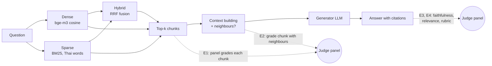
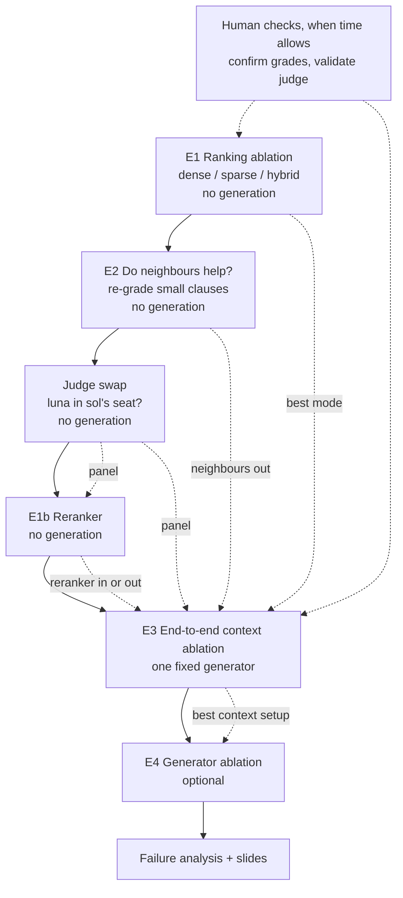

# Ablation plan: retrieval, context and generator (on the frozen chunks)

Status: draft 2026-10-23. Tracks what we run next, and why, now that the corpus and the chunks are frozen. The details behind each earlier decision are in `generation-and-eval.md` (generation, judges, top-50 diagnostic) and `rag-baseline.md` (chunking, retrieval). This file is meant to be read on its own.

## Where we are

| Done | Not done |
|---|---|
| Corpus settled; **2,070 chunks frozen** from 173 documents (a test fails if they change) | Any answer run on the frozen chunks. Both earlier dev runs, their human labels and the top-50 diagnostic were made on the **old** chunks, so they are background, not results |
| Retrieval: dense (bge-m3), sparse (BM25), hybrid (RRF) | E3 onward (E1 and E2 are done, see the Log) |
| Generation (`rag/answer.py`) and a demo (`demo.py`) | A generator we can report: the only one so far is a GPT dev stand-in, from the same family as one judge |
| Answer scoring: RAGAS faithfulness, RAGAS answer relevance, rubric judge; a three-judge panel checked against human labels | Ablations, failure analysis, slides, the AI audit in the course template |

**Constraint:** people have little review time right now. Everything on the critical path below runs without a person; human checks are listed separately and make the same results stronger when done.

## The system in one picture

Each experiment changes or measures one part of the pipeline (E1–E4 below).

- **Chunks** are one structural unit when it fits (a FAQ item, a มาตรา, a ข้อ or an `(N)` item of a legal instrument, a guide section), at most 512 tokens. Legal clauses are the smallest: median 148 tokens, 189 under 100. Each chunk's header carries the document title and the parent clause's opening words.
- **Judge panel**: three LLM judges from different families (`gpt-6-sol`, Claude Haiku 5.5, DeepSeek V4.1 Flash), combined by median. On the dev labels it agreed with people about as well as people agree with each other, but it is more lenient than people on hard questions: in the top-50 diagnostic people kept 25 of 132 chunks the panel called "answers it". So panel numbers are reliable for **comparing variants** (the same judges grade every variant) and too generous as **absolute** numbers.

## Plan at a glance

| # | Experiment | Needs generation | Needs a person | Status |
|---|---|---|---|---|
| E1 | Ranking ablation: dense vs sparse vs hybrid | no | no | **done 2026-10-23** (`rag/pooled.py`); summary in the Log, details in `docs/experiments/` |
| E2 | Does adding neighbouring clauses make a chunk answer the question? | no | no | **done 2026-10-23** (`rag/neighbours.py`); summary in the Log, details in `docs/experiments/` |
| S | Judge swap: can gpt-6-luna replace gpt-6-sol in the panel? | no | no | rules fixed 2026-10-23 (`rag/judge_swap.py`), luna grading the E1 pool |
| E1b | Cross-encoder reranker, retrieval only | no | no | after S |
| E3 | End-to-end: does retrieval, a reranker or more context give better answers? | yes, one generator | no | after E1b; generator picked by the smoke test |
| E4 | Generator ablation | yes, 1–3 more generators | no | **optional**, if budget is left |
| H | Confirm the panel's chunk grades; validate the judge on new answers | no | yes | when someone has time |

How this maps to the assignment: **E1 (and E3) is the required ablation** (slides 6–7). The reranker (E1b) is one of the assignment's optional extensions, next to hybrid + RRF. **E3 gives the required ≥ 2 metrics** (RAGAS faithfulness, RAGAS answer relevance, LLM-as-judge; slide 8). Failures found along the way feed slide 9.

## Question sets

| Set | What | Used by |
|---|---|---|
| **Content questions** | All normal and multi-turn questions: 338 (the one out-of-scope question and the 30 behavioural ones excluded, because they test how the answer behaves, not which chunks come back) | E1, E2 |
| **Ablation subset** | Drawn once, with a fixed seed, from questions **not** in the dev set: about 6 per content category (16 categories), all 9 non-dev multi-turn questions (with their earlier turns), all 26 non-dev behavioural questions. About 130 | E3, E4 |
| Dev set | The 40 dev questions. We have read them closely and tried things on them, so they are not used to report answer results | smoke tests only |

E1 includes the dev questions because nothing about retrieval was tuned on them; it is reported both with and without them anyway.

---

## E1 Ranking ablation (dense vs sparse vs hybrid)

**Question.** Which retrieval mode puts chunks that answer the question near the top, and why?

**Design.**

1. For each content question, take the top 10 of dense, sparse and hybrid and pool them (the union). The modes overlap a lot: about 21 distinct chunks per question, about 7,000 pairs in all, against 10,000+ if each mode were graded separately.
2. Each judge grades every (question, chunk) pair once on the rubric's scale: **2** answers it (or a necessary part), **1** on topic but does not answer, **0** not relevant. Chunks are shown in shuffled batches of 10, without the mode or rank they came from, and without any answer.
3. The grades are reused for every mode: a mode's score is computed from where it ranked the graded chunks.
4. About 700 calls per judge. Grades are stored per question, chunk id and chunk text hash, so a later variant (a reranker, k = 10) only grades the chunks it adds.

This reuses the grading code of the top-50 diagnostic (`rag/depth.py`).

**Metrics,** per mode, overall and per category:

| Metric | Meaning |
|---|---|
| hit@5 | share of questions with at least one "2" in the top 5 |
| precision@5 | share of the top 5 graded 2 |
| MRR@10 | 1 / rank of the first "2" in the top 10, averaged |
| nDCG@10 | uses the 0/1/2 grades and their ranks; rewards good chunks near the top |
| recall@10 (pool) | share of the pool's "2"s found in the mode's top 10; relative to the pool, not to the whole corpus |

Each is reported twice: a "2" as the panel **median** (lenient) and as **all three judges** say 2 (strict). Differences between modes are tested per question (paired), with a bootstrap interval.

**Assumptions.**

- The panel's grades are good enough to **rank** modes even though they are lenient. Leniency hits every mode alike.
- Chunks none of the three modes found are never graded, so recall is relative to the pool.
- A chunk is graded alone. A clause that answers only with its neighbours counts as a 1 here; E2 is about that.

**Outcomes and what we do.**

| Outcome | Then |
|---|---|
| Hybrid ≥ both single modes, beyond the interval | Hybrid stays the baseline. Explain the mechanism per category: where BM25 wins (exact terms: form names, section numbers, amounts) and where dense wins (paraphrase, colloquial questions; the "ภาษาพูด" category). |
| A single mode beats hybrid | That mode becomes the baseline for E3. Look at why fusion hurts (e.g. one ranking adds noise at ranks 1–5 for some categories) before changing RRF settings. |
| Differences inside the interval | Report "no measurable difference"; keep hybrid for robustness and say so. The ablation is still valid: explaining why they tie is the point. |
| Median and strict disagree on the winner | Report the result as unsure. A person grades a sample of the disputed chunks (H1) before E3 relies on it. |
| Many questions with no "2" anywhere in the pool | Corpus gaps or wording mismatch, not ranking. List them for failure analysis; do not tune on them. |

---

## E2 Do neighbouring clauses help?

**Pre-review (2026-10-23).** Before spending judge calls, 10 later-part chunks (3 clause, 4 statute, 3 annex, each a distinct chunk) were marked by hand on "would the missing text make this chunk answer the question": 1 yes, 3 unsure, 6 no. By type: clause 0 yes of 3; statute 1 yes, 1 unsure, 2 no of 4; annex 0 yes, 2 unsure, 1 no of 3. A first read of 7 random 1-graded chunks agreed: most 1s are on-topic misses (the chunk is about a different subtopic), not clauses missing a condition next door. So the expected effect is small, the clause stratum most of all, and the plan keeps the cost low and the strata separate.

**Question.** Legal clauses are small. Is a clause often "on topic but not enough" because the condition, exception or definition it needs sits in the next clause?

This is a **hypothesis**, not a finding. Part of the gap is already covered: a clause's header includes the opening words of its parent มาตรา or ข้อ. What the header does **not** carry is sibling items ("ทั้งนี้ …", exceptions, definitions in another ข้อ).

**Design.**

1. Take chunks in the **dense or hybrid** top 5 that the panel graded **1** in E1, in two strata reported separately:
   - **Clause stratum:** `origin == "clause"` (218 chunk-question pairs, 115 questions).
   - **Later-part stratum:** a later part (part > 1) of a split statute, annex or clause unit (59 pairs from 12 distinct chunks; the 14 later-part clause pairs stay in the clause stratum, and 16 distinct chunks cover all 73). The missing text here is the earlier part of the same unit, so the neighbour is clear. Windows, FAQ and guide chunks are not expanded: window neighbours are adjacent slices of an article (a context-size question that E3's k = 10 control covers), and a FAQ chunk carries its own question and answer.
   - Three chunks account for 41 of the 73 later-part pairs, so also report the conversion **per distinct chunk**, not only per pair. Sparse is clearly worst in E1, so its top 5 adds many 1s nobody would serve and would dilute the conversion rate. Chunks found only by sparse are left out; as a check, also report the result for the chunks in the dense top 5 and for those in the hybrid top 5 (the two groups overlap).
   - Leave out the **boilerplate** chunks (a decree's last มาตรา on who is in charge of enforcement, signatures). Neighbours will not fix them. Count how many were dropped. Run: none; no boilerplate chunk is in any mode's top 5 in E1.
2. Grade each twice more, in the same blind setup as E1:
   - **expanded**: the chunk plus its neighbours (siblings in the same parent unit; capped, e.g. 512 extra tokens);
   - **alone again**: the same chunk as in E1, as a control. A 1 can become a 2 just by asking again, and this measures how often.
   - Run both conditions on **one route per judge**. In E1, gpt-6-sol was graded over two routes (OpenAI direct, then OpenRouter) that were never compared. Run: all judges on OpenRouter, so the route effect cancels in expanded minus alone and no separate drift check was needed.
3. Also expand a sample of chunks graded **2**, to see whether neighbours dilute them.
4. Mark the questions with **no "2" in the E1 pool** (31 by the median, 56 by the strict rule). They are reported as their own group (see Metric).

A few hundred calls in all.

**Metric.** The share of 1s that become 2 when expanded, minus the share that become 2 when asked again alone (the noise floor). Report it overall, per source mode, and for the **no-"2" questions** on their own. A conversion there is the strongest evidence for the hypothesis, because it recovers questions that no ranking change can fix. If none convert, those questions are corpus or wording gaps and go to failure analysis.

**Assumptions.**

- "Neighbour" means the same parent unit. The previous and next chunk in the file can belong to another section, so they are only a fallback.
- A judge that can see more text is not simply more generous. The "alone again" control and the dilution check are there to catch that.

**Outcomes and what we do.** The threshold is to be agreed before the run (proposed: 10 points over the noise floor).

| Outcome | Then |
|---|---|
| Expanded clearly above the floor | Neighbours become a variant in E3. |
| About the floor | Neighbours do not help at this level; E3 runs without them. Report it as a tested and rejected idea: a measured negative result is good ablation material. |
| Expansion often turns 2s into 1s | Expansion dilutes; if it is still tried in E3, add only the parent's opening words or a smaller cap. |
| The gains come from a few document types | Expand only those (e.g. legal clauses), not FAQ items, which already contain their own question and answer. |
| Gains only in the later-part stratum | Expand later parts of split units only (the earlier part of the same unit); do not expand whole clauses. |
| Gains appear only on the no-"2" questions | Neighbours help where nothing else answered; keep them as an E3 variant but expect a small overall effect. |

---

## Judge swap (before E1b)

**Why.** The budget is tight and gpt-6-sol is about 70% of every judge bill. gpt-6-luna is the same family at about a twentieth of the price. E1b only grades the chunks a variant adds, so sol would be cheap there; the saving is in E3, which grades answers. The swap is checked once, on E1's pool, so the check also tells us whether luna is a fit judge for E3.

**Design.**
1. luna (`judge-luna-or`: OpenRouter, reasoning effort medium as sol) grades the whole E1 pool, 7,018 pairs in E1's own batches (875 calls, about $0.6 at a measured $0.00067 a call).
2. One pass. Questions go in a seeded random order and each batch is saved as it is graded, so a run cut off part way (OpenRouter's daily limit) leaves a random sample of fully graded questions; the check uses only those, for both panels. The third judge decides the panel grade on 37% of the pairs (haiku and DeepSeek differ, or both say 2), spread over 787 of the 875 batches, so grading those first would save nothing.
3. `rag/judge_swap.py` compares, with rules fixed before luna's grades existed:

| Level | Passes if |
|---|---|
| Pairs | luna's exact agreement with each of sol, haiku and DeepSeek ≥ .72 (the panel agrees .76–.79 within itself); 2-point gaps under 2%; luna's share of 2s at most sol's + .05 |
| Results | E1 with the new panel (luna, haiku, DeepSeek; a 2 is the median) ranks the three modes in the same order on every metric, and each of the 15 differences between modes lies inside the old one's 95% interval |

With haiku standing in for luna, the check passes (this is how the code was tested): a panel without sol already gives E1's ordering.

**Outcomes and what we do.**

| Outcome | Then |
|---|---|
| Both pass | luna, haiku and DeepSeek grade E1b and E3. E1 is reported under both panels; E1b is compared with E1 under the new one. sol's two-route caveat goes away in the new-panel numbers. |
| Pairs pass, results move | Swap anyway. E1 is reported under both panels and only what holds under both is stated; the moving gap is itself reported as judge-dependent. |
| Pairs fail (low agreement or much more lenient) | No swap. E1b keeps sol (about $3–4). E3 runs with haiku and DeepSeek, a 2 needing both, and sol scores a sample of answers. |
| Cut off part way | The check runs on the questions graded in full. Under about 100 questions, the result level is reported but not used to decide; the pair level decides. |

From the swap on, luna is a judge and not a generator: it would grade its own answers.

## E1b Cross-encoder reranker (retrieval only)

**Question.** Does reading the question and the chunk together (a cross-encoder) rank answering chunks higher than comparing two separate vectors (bge-m3)? On dev, 7 of 13 misses had an answering chunk at ranks 6–50.

**Design.**
- Variant: dense top 50 → a multilingual cross-encoder (`BAAI/bge-reranker-v2-m3`, runs on CPU) → top 10. The candidates are dense's own, so only the order changes: the effect is the reranker's alone.
- Added to E1's pool as a variant (`rag/pooled.py`): only the chunks nobody graded are graded, by the panel S settles on. Expected about 3–5 new chunks per question, about one call per question per judge.
- Metrics and intervals as in E1, against dense, per question.

**Outcomes and what we do.**

| Outcome | Then |
|---|---|
| Reranker above dense, beyond the interval | Into E3. Explain per category; read the questions where a 2 moves into the top 5. |
| No measurable difference | Still into E3 (the answers may differ). Report that cross-encoding does not fix the colloquial-to-formal wording gap. |
| Reranker clearly below dense | Out of E3, to save its cost; report E1b as it is. |

---

## E3 End-to-end context ablation

**Question.** Do the retrieval and context changes give **better answers**? Retrieval metrics alone cannot show this. More chunks change only what the generator sees, not the ranking, so E1-style metrics cannot measure that at all.

"k" here is the number of chunks the generator sees. It is not the RRF constant that `docs/experiments/2026-10-23-hybrid-vs-dense-investigation/` also calls k (hybrid uses RRF 60 throughout).

**Design.** One fixed generator, the ablation subset, k = 5 unless stated. Each variant produces a run; the panel scores every answer.

| Variant | Shows | Priority |
|---|---|---|
| No retrieval (the generator answers without sources) | a lower bound: what retrieval adds. Faithfulness does not apply; the rubric is graded against the baseline's chunks, so "correct" means the same in every variant | must |
| Baseline: dense (E1, weakly) | | must |
| Dense + reranker (E1b) | whether E1b's gain reaches the answers | unless E1b rules it out |
| Baseline, k = 10 | whether **more context** helps or lookalikes distract | should |
| Hybrid | whether E1's near-tie carries over to the answers | drop first |
| ~~Baseline + neighbours~~ dropped after E2 (+.06 on clauses, below the 10-point rule) | | |

**Generator.** One open model from a family none of the judges is in, picked by E4's smoke test (about 8 dev questions per candidate, read, not scored). Not luna: it judges from the swap on.

**Judge check.** If S swaps, sol scores 30 E3 answers spread over the variants (about $1–1.5); report luna against sol and the new panel against the old on grounded, correct and useful.

**Cost** (new panel, about 130 questions a variant): about $1.2 per variant; 4–5 variants about $6–7.5.

**Metrics.**
- RAGAS **faithfulness**: share of the answer's claims supported by the retrieved text.
- RAGAS **answer relevance**: whether the answer addresses the question.
- **Rubric** (grounded, correct, useful) and the per-chunk relevance the rubric records.
- For behavioural questions, behaviour only (did it ask back, correct the premise).

All per category, compared per question.

**Assumptions.**

- The generator is the same in every variant and from another family than the judges, so no judge grades its own model's answers.
- About 130 questions are enough to see a difference of a few tenths on the 0–2 scales; anything smaller is reported as noise.

**Outcomes and what we do.**

| Outcome | Then |
|---|---|
| No retrieval far below baseline | Retrieval matters; give the size per category. |
| No retrieval about baseline on "correct" | The generator already knows Thai tax. The difference is in faithfulness and citations; show per category where it gives outdated tax-year figures. |
| Reranker better in E1b and in E3 | E1-style grades predict answers, so later ranking changes can be screened with E1 alone, cheaply. Adopt the reranker for the demo. |
| Reranker better in E1b but not in E3 | The generator is the bottleneck, or the panel's leniency hides it. Read the questions where a 2 moved into the top 5 but the answer did not improve. Later retrieval changes must be tested end to end. |
| Dense and hybrid differ in E3 although E1 was a near-tie | Read those questions: the generator reacts to something the chunk grades miss (lookalikes, order). |
| k = 10 above baseline | Adopt k = 10; check per category whether the gain comes from questions whose answering chunk was at ranks 6–10 in E1. |
| k = 10 below baseline | Extra chunks distract the generator (lookalikes graded 1, see E1); keep k = 5 and report it. |
| Nothing differs beyond noise | Keep the baseline. Report the smallest difference about 100 content questions can show, and what was tried. |

---

## E4 Generator ablation

**Question.** How much does the generator matter, given the same retrieved context?

**Design.**
- Context setup from E3; the ablation subset.
- 3–4 generators chosen **on design grounds**, not by trying them on dev: a small open model (about 8B, Qwen or Gemma), a mid-size open model, a small GPT model. Possibly a Thai-tuned model next to its own base model (e.g. OpenThai 2.0 vs the Qwen it is built on) as a "does Thai tuning help" pair.
- Before the run, a **smoke test** on about 8 dev questions per model: Thai output, `[n]` citations kept, asks back when it should, no truncation, rate limits. These answers are read, not scored.
- Scored by the panel as in E3, including per-chunk relevance.

**Metrics.** As in E3, per category; calculation and behavioural questions called out. **Each judge's score is reported next to the panel's**, so a judge favouring its own family (gpt-6-sol on the GPT generator) shows up instead of being assumed away.

**Assumptions.**
- The panel's two non-OpenAI judges keep the GPT generator from being favoured by the median.
- The ablation subset excludes dev, so the models were not chosen on the questions they are scored on.

**Outcomes and what we do.**

| Outcome | Then |
|---|---|
| Clear ranking of generators | Use the best affordable one for the demo; explain where the others fail (by category). |
| The GPT generator wins only with gpt-6-sol, not the other judges | Treat it as possible self-preference; report the panel without sol as a check. |
| Small models fail on behaviour (no ask-back, no premise correction) but not on facts | Report it as a finding: retrieval is shared, so the gap is the generator's instruction following. |
| All generators fail on the same questions | Those are retrieval or corpus problems, not generation. Cross-check them with E1 grades for failure analysis. |

---

## H Human checks (when someone has time)

None of these block E1–E4. Each turns a judged number into a checked one.

| # | Check | Effort | Makes stronger |
|---|---|---|---|
| H1 | A person confirms the panel's "2"s for a sample of E1 questions (the plan's original qrels step) | about 1–2 hours per person per 30 questions | E1 metrics become human-checked qrels; also re-maps the 63 old chunk labels whose text changed |
| H2 | A person grades about 30 E3 or E4 answers on the same rubric; report agreement with the panel | about 1–2 hours | The judge's validity on the frozen chunks and the new generator |
| H3 | Read the questions where judges disagree by 2 points | small | Contested cases for failure analysis |

## Open decisions

| Decision | Options | Needed by |
|---|---|---|
| Generator for E3 | Decided: an open model from a family none of the judges is in, picked by the smoke test; not luna (a judge after S) | E3 |
| Generator list for E4 | Optional now; if budget is left, one or two more generators on E3's baseline context | E4 |
| Judge panel from E1b on | Decided: luna in sol's seat if S passes | E1b |
| E2 threshold | 10 points over the noise floor, as proposed; not met (+.06 on clauses) | done |
| Neighbour definition | Used: the other parts of the same unit, then sibling units under the same parent (nearest first, next before previous), at most 512 extra tokens | done |
| Corpus gaps (Q0111 general mutual-fund gains, Q0145 documents for a first online filing) | Report only (proposed: adding sources would move chunk ids) | before E1 |

## Known limits (state them in the report)

- Panel grades are lenient on hard questions; absolute scores run high. Comparisons between variants are the reliable part.
- Recall is relative to the graded pool.
- Some of the smallest chunks are boilerplate (a decree's last มาตรา "ให้รัฐมนตรีว่าการกระทรวงการคลังรักษาการ…" plus signatures; 15 chunks). In E1 none reached any mode's top 5, so they do not take retrieval slots there.
- Two corpus gaps are known (Q0111, Q0145). No variant can fix them.

## Log

Newest entry last. Each entry: what was done, the numbers, the likely cause, what is still open. All dates 2026-10-23.

### Plan written

- E1 is retrieval-only: pooled grading costs about 10× less than generating and scoring answers for each mode.
- E3 is added as the bridge from retrieval to answer quality.
- E2 is added to test the small-clause assumption before spending on generation.

### E1 ranking ablation (2026-10-23, done)

Details: [`docs/experiments/2026-10-23-e1-ranking-ablation/`](../experiments/2026-10-23-e1-ranking-ablation/README.md).

- Sparse is clearly worst: hybrid beats it by about 0.2 on every metric.
- Dense is at least as good as hybrid: hit@5 .717 vs .699 (inside the interval), nDCG@10 .695 vs .664 and recall@10 .686 vs .608 (outside). By the outcome table: "a single mode beats hybrid", weakly.
- Caveats: gpt-6-sol was graded over two routes (OpenAI direct, then OpenRouter) that were not compared; 31 questions (56 strict) have no 2 in the pool.
- Effect on E2 (plan updated after reading this): the sample comes from dense and hybrid top 5 only, boilerplate is excluded, the no-"2" questions are reported as their own group, and sol's route drift is measured next to the "alone again" control (in the run, all judges went on OpenRouter, so this was not needed; see the E2 entry). E3's baseline row is now dense.
- Pre-review of the E2 sample (hand-marked, 10 chunks): 1 yes, 3 unsure, 6 no, so E2 stays clause-led and adds a separate later-part stratum (statute, annex) because that is where the yes and unsure marks were. The 73 later-part pairs come from only 16 distinct chunks, so E2 is also reported per chunk. One marked chunk was a keyword match on ค่าตอบแทน in an insurance-agent clause: leniency from matching terms, for failure analysis.

### E2 neighbouring text (2026-10-23, done)

Details: [`docs/experiments/2026-10-23-e2-neighbours/`](../experiments/2026-10-23-e2-neighbours/README.md).

- 277 chunks graded 1 in E1 (218 clause, 59 later-part from 12 distinct chunks), each graded alone and with neighbours by the three judges on OpenRouter; 54 chunks graded 2 as a dilution check.
- Share of the 1s that become 2, expanded minus alone: +.05 [+.01, +.09] overall, **+.06 [+.02, +.10] on clauses** (the upper end touches the 10-point rule; the decision rests on the estimate), .00 [−.11, +.12] on later parts, +.03 [−.09, +.11] on the no-"2" questions. Strict gives the same size. Sol, haiku and DeepSeek each give +.03 to +.05. The noise floor is about 10%.
- Only 17 of 123 distinct chunks gain; neighbours do not dilute good chunks (dilution .00).
- By the outcome table: below the 10-point rule, a small real effect on clauses. The 1s are mostly on-topic misses, not clauses missing a condition next door. Neighbours are out of E3; the k = 10 control stays.
- Open: E2 measures the panel's chunk grades, not answers; the later-part result rests on 12 chunks. Sol stopped once on OpenRouter's credit limit (217 of 314 calls were cached and reused).

### Judge swap rules fixed (2026-10-23)

- Budget is tight: luna replaces sol from E1b on if it passes the check in "Judge swap". Rules and outcome table written, and `rag/judge_swap.py` tested with haiku standing in for luna, before luna graded anything.
- OpenRouter's key had $0.34 of its $8 daily limit left at the start, enough for about 500 of the 875 calls; the pass is ordered so a cutoff leaves a random sample of whole questions.
- E3 revised: no-retrieval lower bound and a reranker (E1b) added; hybrid is the first variant to drop; the generator is an open model; E4 is optional.

### E3 generator and baseline answers (2026-10-23)

- Generator fixed: Typhoon (`typhoon-v2.5-30b-a3b-instruct`, profile `typhoon`), after the smoke test in `generation-and-eval.md`. A Qwen3-based model, from none of the judges' families.
- Ablation subset drawn: `rag/eval/ablation_questions.txt`, `rag.questions.draw_ablation(seed=20261023)`, 131 questions (96 content, 6 from each of 16 categories; the 3 non-dev multi-turn sets, 9 turns; all 26 non-dev behavioural), none in dev.
- Baseline generated, not yet scored: `rag/out/runs/20261023-ablation-typhoon-dense-k5-v1` (131 calls, 2m50s, 449k tokens in, 63k out, free). The 105 content questions got exactly E1's dense top 5; retrieval code is unchanged. 5 answers cite nothing, each a "ไม่พบข้อมูลนี้ในเอกสารอ้างอิง" on a retrieval miss (Q0119, Q0120, Q0244, Q0250, Q0260); one cites [6] of 5 sources (Q0334, turn 3 of a set).
- k = 10 generated, not yet scored: `rag/out/runs/20261023-ablation-typhoon-dense-k10-v1` (131 calls, 3m10s, 833k tokens in, 66k out). Its first 5 sources are the baseline's on every question; 88 answers cite a source at rank 6–10. Spot check: Q0244 and Q0250 declined at k = 5 and answer at k = 10 from a rank 6–10 source (มาตรา 63; the ภ.ง.ด.90/91 instructions); Q0298 answered at k = 5 and opens with "ไม่พบข้อมูล" at k = 10 before giving the same rule (a hedge, possibly lookalikes). Q0248 at k = 5 declined while citing "[1] ถึง [5]", so a decline can count as cited.
- No retrieval generated, not yet scored: `rag/out/runs/20261023-ablation-typhoon-none-n1` (`--mode none`, prompt `n1`: SYSTEM's rules without the sources-only and citation ones; 131 calls, 2m39s, 47k tokens in, 76k out). No [n] and no mention of sources in any answer; it never declines (the baseline does 14 times) and names a tax year in 125 answers, mostly 2567. Spot check: Q0119 calls the gain on selling a personal car taxable property income, where the baseline declined; Q0355 names a form that does not exist ("ภ.พ. ง. ด. 01").
- **Chinese inside Thai answers (raw runs).** Typhoon (Qwen3-based) writes 申报 ("file a return") in Thai sentences: 10 of 131 answers at k = 5 (Q0035 Q0074 Q0106 Q0129 Q0270 Q0292 Q0336 Q0351 Q0363 Q0368), 9 at k = 10 (Q0007 Q0104 Q0106 Q0129 Q0148 Q0224 Q0293 Q0336 Q0368), 38 without retrieval (also 免税, 导致, 自愿). Retried without the cache, the 9 single-turn k = 5 cases leaked in 14 of 27 calls (Q0035, Q0129, Q0368 every time; Q0074, Q0292, Q0363 never), 12 clean questions in 0 of 24, so it is per-question and random, not a fault in the call. Typhoon is not deterministic at temperature 0: no retry matched the cached answer, so runs reproduce only through the cache. A "Thai script only, no Chinese" prompt rule still leaked on 4 of 9. These three runs stay as they are, as the raw record and failure-analysis examples; the scored E3 runs retry such answers (next entry).
- Next: E3 runs that retry an answer with Chinese, Japanese or Korean text; scoring waits for the judge-swap decision.
